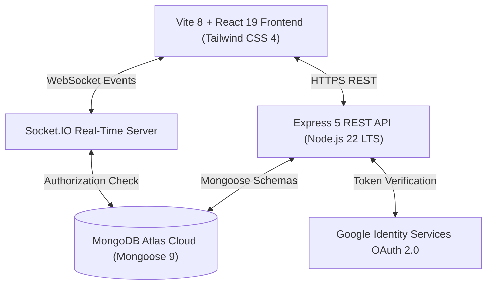

# 🚀 Thapar Journey Connect

[](https://nodejs.org)
[](https://react.dev)
[](https://expressjs.com)
[](https://www.mongodb.com)
[](https://tailwindcss.com)
[](#-automated-testing--quality)
[](#-license)

> **Campus-Exclusive Transit & Travel Cohort Network**  
> Built specifically for students, scholars, and staff of **Thapar Institute of Engineering & Technology (TIET), Patiala**.  
> Eliminate chaotic, unverified WhatsApp and Telegram transit chats with a unified, safe, and automated ride-pooling and intercity cohort platform.

---

## 🧭 What We Are Building

At Thapar Institute, thousands of students travel between the Patiala campus, railway stations (Patiala, Ambala Cantt, Chandigarh, Rajpura), airports (Mohali/Chandigarh IXC, Delhi DEL), and major hometown corridors every weekend and holiday. 

**Thapar Journey Connect** replaces unorganized social media posts with an intelligent, secure transit operating system:

1. **15-Minute Slot-Based Departures (Two-Way Travel)**: Instant join and discovery across 96 slots/day for both **Departing** (Campus ➔ Station/City) and **Returning** (Station/City ➔ Campus) journeys.
2. **Transparent Fair Fare Splitting**: Automatic real-time fare calculation split 1, 2, 3, or 4 ways with companion reservation support.
3. **Train & Bus Travel Cohorts**: Dedicated student travel groups for intercity rail (Shatabdi, Vande Bharat, Intercity) and bus (PRTC, Volvo, Zingbus) lines with cross-community discovery.
4. **Hometown Community Hubs**: City-specific student communities (Delhi NCR, Chandigarh, Jalandhar, Ludhiana, etc.) with localized notice boards, rides, and peer coordination.
5. **Institutional Security & Contact Privacy**: Restricted strictly to verified `@thapar.edu` accounts with automated single-ride protection, phone number masking for outsiders, and real-time Socket.IO chat.
6. **Premium Minimal UI/UX**: Fast, distraction-free interface built with Tailwind CSS 4, supporting system-level Light and Dark modes.

---

## 🌟 Key Features

### 🚖 1. Slot-Based Shared Rides & Two-Way Travel
- **15-Minute Departure Windows**: 96 standard slots per day (`00:00`, `00:15`, `00:30`, ..., `23:45`) covering all major campus travel corridors.
- **Direction Switch Toggle**:
  - **Departing**: Campus (Hostels) ➔ Transit Destination.
  - **Returning**: Transit Destination ➔ Campus (Hostels).
  - Slots operate with distinct composite keys ensuring bidirectional groups never collide.
- **Dynamic Virtual Slots & Lazy Group Creation**: Empty slots display as `0/4 seats`. When the first student joins, a sequential `Group #ID` (e.g. `Group #12`) is atomically provisioned.
- **Capacity Limits & Single-Ride Policy**: Enforces a strict 4-passenger limit per cab and guarantees a student can only belong to one active ride at a time.
- **Atomic Slot Rescheduling**: Seamlessly move between slots with automated time-based reliability penalties ($\le 4\text{h}: -0.3\star, \le 30\text{min}: -0.8\star$).
- **Companion Booking (+1 Friend)**: Students can bring a peer into an open ride; seats and fare splits update atomically.

### 🚆 2. Train Groups & 🚌 Bus Groups
- **Intercity Cohort Coordination**: Alongside cab rides, students can coordinate long-distance rail and bus travel without paying middleman fees.
- **Self-Booking Model**: Students book their own official IRCTC train or bus tickets; the platform facilitates travel cohorts, coach meetups, and station safety.
- **Train Cohort Fields**: Train name/number (e.g. `12005 Kalka Shatabdi`), date, departure time, boarding station, destination, and travel class (`CC`, `EC`, `3A`, `2A`, `1A`, `SL`, `2S`).
- **Bus Cohort Fields**: Bus operator (e.g. `PRTC AC Volvo`, `Zingbus`), date, departure time, boarding point (e.g. `Patiala Bus Stand Counter 4`, `Patiala Bypass`), and destination.
- **Cross-Community Discovery**: Students can discover, search, and join train/bus groups across any city without modifying or forfeiting their native hometown community membership.
- **Dedicated Cohort Chat**: Integrated real-time Socket.IO group chat restricted exclusively to joined members.
- **Admin Succession & Auto-Archival**: If the creator leaves, leadership automatically transfers to the next senior member; empty cohorts delete automatically.

### 🏙️ 3. Hometown City Communities & Notice Boards
- **Native Regional Hubs**: City hubs for Delhi NCR, Chandigarh Tricity, Jalandhar, Ludhiana, Amritsar, Bathinda, Jaipur, Himachal, and more.
- **Single-Community Hometown Policy**: Students enroll in one native hometown community at a time to prevent spam and preserve high signal-to-noise discussion.
- **Notice Board & Discussions**: Verified hometown members can publish ride requests, travel queries, and coordinate shared travel. Non-members are restricted with HTTP 403.

### ⚡ 4. Intelligent Deterministic Matching Engine
- **Compatibility Scoring**: Matches students traveling to identical destinations based on vehicle preference, flexibility, and hostel quad location.
- **Same-Day Linear Departure Calculation**: Evaluates the actual same-day minute difference between requested departures ($|a - b|$), ensuring early morning departures (e.g. `00:05`) are accurately separated from late-night departures (e.g. `23:55`) on the same travel date.
- **Campus Proximity Resolution**: Incorporates all 18 official TIET hostel halls (Hostel A through Q, PG Residences, and Day Scholar sectors) for optimal pickup clustering.

### 💬 5. Real-Time Chat & Safe Travel Operations
- **Authenticated Socket.IO Rooms**: Encrypted live updates for cab ride rooms (`group_<id>`), travel cohort rooms (`tg_<id>`), and personal notifications (`user_<id>`).
- **Contact Privacy Shield**: Mobile numbers are never exposed in search results or open slots; co-rider phone numbers are unlocked exclusively after journey confirmation or cohort membership.
- **Emergency SOS Dispatch**: One-click modal providing instant access to TIET Campus Security (`+91 175 239 3000`), Thapar Health Center Ambulance, and Patiala Police Control.

---

## 🛠️ Technology Stack



| Layer | Technologies |
|---|---|
| **Frontend** | React 19, Vite 8, Tailwind CSS 4, Lucide React Icons |
| **Backend API** | Node.js 22 LTS, Express.js 5, Socket.IO 4 |
| **Database** | MongoDB Atlas Cloud, Mongoose 9 ODM |
| **Authentication** | Google Identity Services (GIS), `google-auth-library`, JWT, bcryptjs |
| **Testing** | Node native test runner (`node:test`), Supertest, MongoMemoryServer, Oxlint |
| **Production Hosting** | Render Web Service (`render.yaml`), HTTPS, Automatic CI/CD |

---

## 📂 Repository Structure

```
Thapar_Journey_Connect/
├── .github/
│   └── workflows/
│       └── ci.yml             # GitHub Actions CI (Lint, Build, 64 Tests)
├── public/
│   ├── favicon.svg            # Platform favicon
│   ├── thapar-banner.png      # High-res campus banner
│   └── thapar-campus.png      # Campus background visual
├── server/
│   ├── app.js                 # Express application & route mounts
│   ├── index.js               # HTTP + Socket.IO server entry point
│   ├── config/
│   │   └── db.js              # MongoDB Atlas connection & seed logic
│   ├── middleware/
│   │   ├── auth.js            # JWT verification & session resolution
│   │   ├── errors.js          # Centralized error handler
│   │   ├── rateLimit.js       # IP & email-based auth rate limiters
│   │   └── validate.js        # Request schema validation
│   ├── models/
│   │   ├── CityRide.js        # City community cab departures
│   │   ├── Community.js       # Hometown communities
│   │   ├── CommunityGroup.js  # Discussion notice boards
│   │   ├── Counter.js         # Atomic sequential ID generator
│   │   ├── Destination.js     # Campus & destination points
│   │   ├── Group.js           # Shared cab ride groups
│   │   ├── Hostel.js          # 18 TIET residential halls
│   │   ├── Journey.js         # Student travel requests
│   │   ├── Message.js         # Cab ride group chat messages
│   │   ├── TravelGroup.js     # Train & Bus travel groups & messages
│   │   └── User.js            # Student profile & credentials
│   ├── routes/
│   │   ├── auth.js            # Google SSO & campus credentials
│   │   ├── communities.js     # Hometown hubs & community slots
│   │   ├── communityGroups.js # Notice boards & posts
│   │   ├── groups.js          # Active ride groups & actions
│   │   ├── journeys.js        # Ride matching queries
│   │   ├── slots.js           # 15-minute slot engine (Two-Way)
│   │   └── travelGroups.js    # Train & Bus group operations & chat
│   ├── services/
│   │   ├── groups.js          # Group state lifecycle & completion
│   │   ├── matching.js        # Matching algorithm
│   │   ├── notifications.js   # Socket.IO emitter helpers
│   │   └── serializers.js     # Privacy masking & serializers
│   └── utils/
│       └── time.js            # IST timezone calculations
├── src/
│   ├── App.jsx                # Root frontend container & routing
│   ├── main.jsx               # React 19 entry point
│   ├── index.css              # Tailwind CSS 4 theme rules
│   ├── components/            # Reusable UI components & modals
│   ├── context/               # Auth & Theme (Dark/Light) providers
│   ├── data/                  # Destinations, hostels & cities
│   ├── hooks/                 # Data synchronization hooks
│   ├── pages/                 # Full-page views
│   │   ├── AuthPage.jsx       # Google SSO & campus credentials login
│   │   ├── CityCommunityHubPage.jsx # Cab rides, trains, buses & board
│   │   ├── CommunitiesPage.jsx# Directory & hometown hub
│   │   ├── DashboardPage.jsx  # Main slot browser & ride booking
│   │   ├── GroupDetailsPage.jsx # Confirmed ride details & actions
│   │   ├── MatchingResultsPage.jsx # Ride compatibility matches
│   │   ├── MyJourneysPage.jsx # Active & past ride history
│   │   └── ProfilePage.jsx    # Student profile & settings
│   ├── services/
│   │   └── api.js             # Client API service & Socket.IO client
│   └── utils/
│       └── matchingEngine.js  # Client-side 15-min slot utilities
├── tests/
│   ├── acceptance.test.js     # 55 Core Acceptance Tests
│   └── travelGroups.test.js   # 9 Train & Bus Acceptance Tests
├── package.json               # Node 22 dependencies & scripts
├── render.yaml                # Render Web Service deployment spec
└── vite.config.js             # Vite 8 configuration
```

---

## ⚡ API Overview

| Route | Method | Description | Access |
|---|---|---|---|
| `/api/auth/google` | `POST` | Authenticate with official `@thapar.edu` Google ID token | Public |
| `/api/auth/login` | `POST` | Campus credentials authentication fallback | Public |
| `/api/auth/logout` | `POST` | Revoke session token and increment token version | Authenticated |
| `/api/slots` | `GET` | List 15-minute slots with date, direction, and capacity | Public (Masked) |
| `/api/slots/:slotKey/join` | `POST` | Atomically join a 15-minute cab departure slot | Authenticated |
| `/api/slots/reschedule` | `POST` | Reschedule from Slot A to Slot B with penalty evaluation | Authenticated |
| `/api/groups/:id` | `GET` | Get ride group details, member statuses, and fare split | Co-Riders |
| `/api/groups/:id/messages` | `GET`, `POST` | Read and broadcast group chat messages | Co-Riders |
| `/api/groups/:id/companion`| `POST`, `DELETE` | Add or remove traveling friend (+1 seat) | Admin |
| `/api/travel-groups` | `GET`, `POST` | Search, filter, or create Train & Bus travel cohorts | Authenticated |
| `/api/travel-groups/:id/join` | `POST` | Join a train or bus group across any community | Authenticated |
| `/api/travel-groups/:id/leave`| `POST` | Leave cohort, transfer admin, or auto-archive | Members |
| `/api/travel-groups/:id/messages`| `GET`, `POST` | Real-time chat messages for train/bus cohort | Members (403 for others) |
| `/api/communities` | `GET`, `POST` | List hometown hubs or create a new community | Authenticated |
| `/api/communities/:id/join` | `POST` | Enroll in native hometown community (Single-community rule) | Authenticated |
| `/api/health` | `GET` | Service uptime and MongoDB connectivity check | Public |

---

## 🧪 Automated Testing & Quality

The platform includes **64 comprehensive acceptance tests** executed natively via Node.js (`node:test`) and an in-memory MongoDB server:

```bash
# Run all 64 automated acceptance tests
npm test

# Run Oxlint linter (0 errors, 0 warnings)
npm run lint

# Build Vite production bundle
npm run build
```

```
✔ Thapar Journey Connect - Acceptance Tests (55 tests)
✔ Train Groups & Bus Groups - Feature Acceptance Tests (9 tests)
ℹ tests 64
ℹ suites 2
ℹ pass 64
ℹ fail 0
```

### Key Acceptance Scenarios Enforced:
1. **Google Domain Isolation**: Rejects personal `@gmail.com` accounts and unverified email payloads (HTTP 400).
2. **Single-Ride Policy**: Concurrent or sequential attempts to join multiple active groups are rejected (HTTP 409).
3. **Capacity Enforcement**: Adding a 5th passenger to a 4-seater cab is blocked atomically (HTTP 409).
4. **Rescheduling Protection**: Payload identity spoofing is rejected; student identity is strictly derived from server authentication.
5. **Cross-Community Train/Bus Cohorts**: Delhi students can discover and join Chandigarh train/bus cohorts without mutating native hometown membership.
6. **Chat Security**: Outsiders attempting to read or send chat messages receive HTTP 403 Forbidden.
7. **Contact Privacy**: Student phone numbers remain masked for outsiders and are revealed only to confirmed co-riders.
8. **Reliability Score Deductions**: Late cancellations within 4 hours deduct $-0.3\star$; within 30 minutes deduct $-0.8\star$.
9. **Two-Way Slot Segregation**: Departing (Campus ➔ Station) and Returning (Station ➔ Campus) operate on collision-free slot keys.

---

## 🚀 Local Development Setup

### 1. Prerequisites
- **Node.js**: $\ge 22.0.0$
- **npm**: $\ge 10.0.0$
- **MongoDB Atlas Connection URI** (or a local MongoDB replica set; ride writes use transactions)

### 2. Installation
```bash
git clone https://github.com/SPRIYANS2006/Thapar_Journey_Connect.git
cd Thapar_Journey_Connect
npm install
```

### 3. Environment Configuration
Create a `.env` file in the root directory:
```env
PORT=5000
NODE_ENV=development
MONGODB_URI=your_mongodb_atlas_connection_string
SESSION_SECRET=thapar_secret_session_key_minimum_32_characters_long!
GOOGLE_CLIENT_ID=your_google_oauth_client_id.apps.googleusercontent.com
APP_ORIGIN=http://localhost:5173
```

### 4. Running the Application
Start both the Express backend and the Vite frontend concurrently:
```bash
npm run dev
```

- **Frontend Client**: [http://localhost:5173](http://localhost:5173)
- **Backend API**: [http://localhost:5000](http://localhost:5000)
- **API Health**: [http://localhost:5000/api/health](http://localhost:5000/api/health)

---

## 📦 Deployment (Render)

The project includes a production `render.yaml` configuration:
- **Build Command**: `npm ci --include=dev && npm run build`
- **Start Command**: `npm start`
- **Health Check**: `/api/health`
- **Node Engine**: `>=22`

Ensure the following environment variables are set in your Render dashboard:
- `MONGODB_URI`
- `SESSION_SECRET` (at least 32 characters)
- `GOOGLE_CLIENT_ID`
- `APP_ORIGIN` (your production frontend URL)

Read [FIXES_AND_DEPLOYMENT.md](FIXES_AND_DEPLOYMENT.md) before deployment, including the required database credential rotation, staging checks, safety limitations and administrator setup. Tests use an isolated MongoDB replica set.

---

## 🛡️ License

Private and proprietary. Developed for the students, researchers, and administration of **Thapar Institute of Engineering & Technology (TIET), Patiala**.
